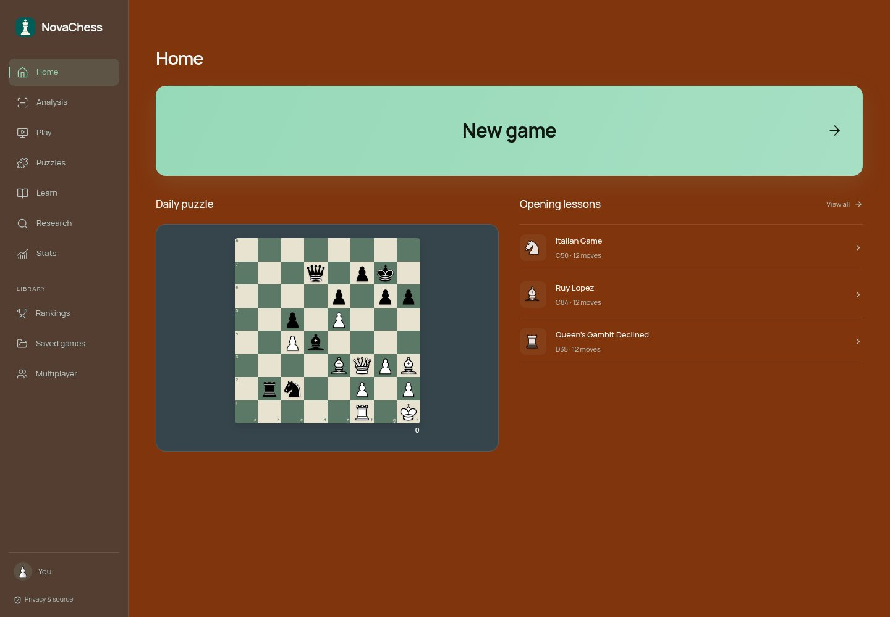

# NovaChess web workspace

A dark, customizable chess workspace following the iPhone app’s **Home, Analysis, Play, Puzzles and Learn** structure, with a dedicated **Stats** page. A standalone clock and camera are omitted; standard online games support 1-, 3- and 10-minute controls.



## Use

Node.js 22.12+; Node 24 is verified.

```sh
npm ci
npm run dev
```

`postinstall` prepares the local Stockfish worker and WASM from the locked npm package. No credentials, account or backend are required.

```sh
npm run build
npm run preview
# Uses /usr/bin/chromium when present; otherwise install Playwright Chromium:
npx playwright install chromium
npm test
```

Set `CHROMIUM_PATH` to use another Chromium binary. The build creates static files in `dist/`, including an offline service worker. Core tools and bundled data are cached after the first successful online load. Piano loads only when enabled and is then cached; public game imports need internet access.

## Features

- **Home:** one large New Game action, a fully clickable daily puzzle, and recent games with result colors and hover-to-scrub position previews. An unlabelled meme beside the puzzle rotates through [public/memes](public/memes/README.md), where all 22 owner-supplied images can be vetted. Each appears once per 22-day cycle; the image also updates when Home stays open overnight.
- **Boards:** continuous diagonal resizing from an external top-right arrow handle with saved per-section sizes and automatic viewport fitting, piece-centered dragging that requires a legal destination containing at least half of the held piece (returned drops stay selected; right-click cancels selection), positive material surplus on the leading side (hidden when balanced), cursor-positioned promotion, configurable right-click marks/arrows, and keyboard controls (`f` flips; `z` enters board-only focus mode). Consecutive premoves preview future piece positions and are checked for legality before execution. Right-click cancels queued moves; Up/Down jump to the first/last position.
- **Play:** standard computer or online games, with Online selected by default and 1/3/10-minute matching. Other modes live in **Variants**, with Throne, Vote Chess and Team Chess first online. Distinct illustrations identify each variant, with a prominent Start game button. Games include persistent state, legal moves, local opponents and a large result banner. Fog of War reveals friendly pieces and attacked squares, conceals opponent move traces, and ends by checkmate. Typed moves are available only in Blindfold text. Below Stockfish’s supported 1320 minimum, opponents start at native 1320 strength and add progressively more errors instead of mapping 1000 to Skill Level 7. These targets still require human calibration.
- **Puzzles:** 4,000 adaptive positions and Guess the Eval, a five-round game scored against an actual local Stockfish search.
- **Learn:** eight illustrated destinations grouped into lessons/practice, chess reference and quizzes/trivia. 129 opening lessons, 32 family guides and 84 playable branches; plans, pawn structures, mistakes, review questions and unassisted recall. The catalog collapses into a compact lesson desk beside the board. Another 32 middlegame workbooks add 176 position-specific annotations and 32 decision exercises. Opening lessons includes 20 playable trap/refutation pairs and defense exercises.
- **Knowledge:** an era-based historical explorer with famous master games, championship timelines with dated ratings, 3,330 searchable encyclopedia entries, 181 trivia questions, and chess-choice personality quizzes.
- **Famous games:** 12 complete annotated master games, key-moment jumps, move-by-move replay, adjustable autoplay, analysis links, saving and full-game GIF export. Saved games also export GIFs.
- **Analysis / Research:** continuous Stockfish search with live depth/evaluation, position-specific explanations of pawn structure, pins, outposts, king cover and legal engine plans, branches, studies, position editor, PGN/image/GIF exports inside Share, notation that follows the current move until manually scrolled, an icon toolbar and separate White/Black move tables for one, two or three top lines. Insights span the side panel, and collapsed notation sits below the board. Research offers NovaChess/Chess.com/Lichess source toggles; arrows show move frequency through opacity without percentage labels on the board. Loading continues when you switch sections; progress and results remain intact.
- **Profile / Controls:** username, bio, default pawn or uploaded avatar, country, attached FIDE/USCF profiles and ratings, personal settings, configurable shortcuts and annotation colors. Auto-queen and legal-move hints default off; premoves default on. Move sounds accept a custom local audio file (up to 1 MB), preview and reset. Profile opens from the bottom account button; Account, Controls and Customize have separate sections.
- **Appearance:** theme presets, 12 palettes, six piece sets, custom colors/background images, bundled country flags, typography, layout, audio and personal presets. Defaults use ocean-blue surfaces, sea-glass accents and softer corner shapes. Charlesworth is selected by name; Nunito Sans remains bundled as a readable fallback. A Charlesworth font file is still needed for consistent rendering on devices without that font installed. Choices with two or three options use toggle bars.
- **Stats:** results, selectable activity ranges (including custom periods), integrated global/country rankings, attached federation records, training, 18 harder achievements, a country map and improvement patterns. Endgame Lessons use the same name throughout the site.
- **Game review:** a board-side evaluation bar, clickable evaluation history, colorful move-quality badges on the board and two-column notation, centipawn loss and per-side game-performance estimates after eight non-book moves. One engine worker retains its search cache across the game, with extra checking for apparent mistakes. Share groups PGN and GIF exports; analysis budgets adjust automatically.
- **Online, when connected:** Supabase accounts, persistent Throne queues, one-day Vote Chess, team rooms versus friends/bots, shared annotations, global chat, and real global/country rankings and percentiles.

Manual file/PGN/settings import controls have been removed as requested. Existing saved data remains readable. Public-game Research loads a named player’s available games through the source API.

## Online setup and browser differences

The local tools work without an account. Online multiplayer, chat and rankings need a Supabase project; the app shows a disconnected state until configured. Follow [the budget-conscious setup guide](docs/ONLINE_SETUP.md), then set the two public Vite variables in `.env.local` or GitHub Actions. A service-role key must never be exposed to the browser.

Federation lookup opens the official FIDE/US Chess record by member ID; official rating/stat ingestion is not claimed. Public-game research depends on the source’s availability and CORS policy. Clock and camera features remain excluded.

## Deploy

Host `dist/` on a static host. The Vite base path is `/NovaChess_website/` for GitHub Pages; hash routes keep navigation within that path. Change the base if hosting at another path. Workers/WASM are included locally and need no cross-origin-isolation headers.

For GitHub Pages, select **Settings → Pages → Source → GitHub Actions**, then run **Actions → Deploy website → Run workflow** on `main`. The CI workflow builds and runs browser tests on pushes and pull requests. Source pushes alone do not publish the website.

## Privacy and licenses

There are no analytics, ads or advertising cookies. Local games, profiles, backgrounds, presets and progress use browser storage. With Supabase connected, accounts, public profiles, multiplayer games, votes, chat and rankings use that project’s database. Service-worker caches hold static application assets. Static hosts and Supabase may retain request logs.

[THIRD_PARTY.md](THIRD_PARTY.md) records artwork, data, fonts, engine source references and music attribution. The source is AGPL-3.0-or-later; see [LICENSE](LICENSE). Piano has its separate CC BY-SA 4.0 license. Full third-party license texts are under `public/licenses/`.

USCF lookup requires the free read-only federation function. Follow the [browser-only setup](docs/ONLINE_SETUP.md#set-up-uscf-lookup-without-installing-anything); it works independently of account sign-in and needs no private keys in the website.

Library separates training studies (including saved branches), recorded games, and NovaChess game history. Studies can be practiced as either color. Library is a main tab below Stats. Multiplayer exposes illustrated Throne, Vote Chess and Team Chess choices even before connection. Throne’s Join queue action reuses an active Throne room; Team invitations preserve the inviter’s side. Live play requires the Supabase setup and the scheduled Vote Chess job.

Game play emphasizes a large board with draw, takeback and resign above a narrow notation rail. Analysis starts with collapsed notation and three adjustable engine lines; study names are entered when saving. Repertoire management remains in Learn. Chat opens as a tall, draggable, panel resizable from every edge and corner, opened from the left sidebar and supports account-based Realtime messages, reporting and server-enforced moderator actions after the [Supabase setup](docs/ONLINE_SETUP.md#global-chat-moderation). Without that connection it is explicitly draft-only.

Speedrun in Play uses 50-point computer rating steps and records only the player’s move time. Stats shows fastest eligible wins by rating and server-recorded time holding the Throne. The Standard card sits above the variant gallery; recent games show players, opponent strength, type and any recorded time control.

Game review begins automatically on opening a game, resumes existing results, and reuses a bounded cache of full-strength evaluations prepared during human turns. Background work is canceled before computer search. Suspicious moves receive deeper verification. Review markers use conventional annotation punctuation; book moves retain a text label and ordinary good moves remain unannotated. Result cards appear centered over the board with player-relative winner wording.

Account settings includes Show memes (on by default). Turning it off places a centered daily puzzle above New game on Home. The remappable Clear arrows shortcut defaults to `c`, preserves square highlights, and leaves the existing Escape cancel/clear action available.

For a low-cost public launch, follow [Multiplayer launch](docs/MULTIPLAYER_LAUNCH.md). The manual **Set up multiplayer** GitHub Actions workflow applies the backend and rebuilds the website after you add your own Supabase project configuration. Cloudflare Pages root hosting is supported with `VITE_BASE_PATH=/`; GitHub Pages keeps its existing path. Google/GitHub OAuth providers are detected automatically, and PKCE avoids conflicts with hash-based navigation. Realtime games subscribe only to their room; the lobby reads a compact view, chat applies changes incrementally and offline releases reuse unchanged assets. `npm run test:online` runs controlled connected-browser tests without a live account; `npm run check:online` checks your deployed services using public configuration.
