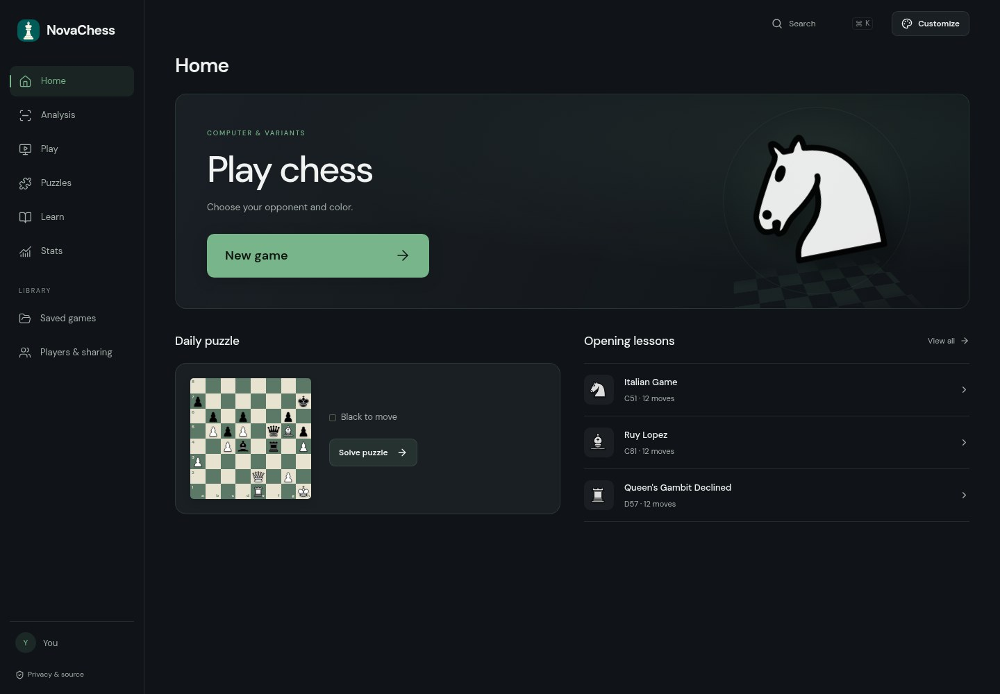

# NovaChess web workspace

A dark, customizable chess workspace following the iPhone app’s **Home, Analysis, Play, Puzzles and Learn** structure, with a dedicated **Stats** page. Clock and camera features are intentionally omitted.



## Use

Node.js 22.12+; Node 24 is verified.

```sh
npm ci
npm run dev
```

`postinstall` prepares the local Stockfish worker and WASM from the locked npm package. No credentials, account or backend are required.

```sh
npm run build
npm run preview
# Uses /usr/bin/chromium when present; otherwise install Playwright Chromium:
npx playwright install chromium
npm test
```

Set `CHROMIUM_PATH` to use another Chromium binary. The build creates static files in `dist/`, including an offline service worker. Core tools and bundled data are cached after the first successful online load. Piano loads only when enabled and is then cached; public game imports need internet access.

## Features

- **Home:** a dedicated New Game section, daily puzzle, suggested opening lessons and recent games.
- **Analysis:** local Stockfish 19 Lite, one/three candidate lines, evaluation, material/check insights, legal moves, FEN/PGN import, position editing, branching, saved studies, FEN/link/PNG/GIF export.
- **Play:** computer games, adaptive strength, Developer opening book, requested openings, all app variants, two-board Bughouse, drops, Duck placement, premoves, underpromotions, takebacks, draw offers and local history.
- **Puzzles:** all 4,000 source puzzles; adaptive selection, automatic replies, hints, first-attempt grading, streaks and a deterministic daily puzzle.
- **Learn:** all 111 curated lessons and 3,865 searchable opening lines, practice, repertoire editing/import/training with transpositions and spaced review, public-game research, 17 playable endgames, 56 facts and 22 historical milestones with championship/event-rating views.
- **Library:** folders, imports, replay, persistent/resumable reviews, repertoire recall suggestions, engine alternatives and exports.
- **Stats:** dedicated navigation, result and activity charts, training/game totals, improvement patterns, 14 achievements and a zoomable country map.
- **Players & sharing:** local profile/avatar/country, local friends, pass-and-play, portable correspondence files, position/game links and read-only shared replays.
- **Appearance:** nine app themes, all 12 board palettes and six piece sets, 12 app background styles plus uploaded backgrounds, custom base/accent/button/text/panel/board colors, background blur/dimming, panel opacity, font/size, spacing, corners, board size, move display, audio, personal presets and settings import/export. Changes persist locally.

## Browser differences

This is a working web adaptation, not a wrapper around SwiftUI. Standard analysis/play uses **Stockfish 19 Lite** with a smaller network than the native app. Variant legality uses **Fairy-Stockfish via ffish-es6**; variant opponents and variant review use lighter local searches/material heuristics. Their strength is not a calibrated human rating.

Apple CloudKit and Game Center are not browser services. The website uses local profiles/contacts and game files/snapshot links instead; it does not invent a live player directory, automatic public broadcasts, matchmaking or cloud synchronization. Saved games and progress belong to this browser. Export backups to keep copies.

Opening research calls the selected service only after a user requests it. Browser CORS, site availability and rate limits apply. PGN-file research works independently of those services. Live Chess.com/Lichess access could not be verified in this cloud instance because its outbound proxy blocked both destinations; representative PGN imports and opening-tree results were validated.

See [feature mapping](docs/APP_REVIEW.md) for source references and differences.

## Deploy

Host `dist/` on a static host. Relative asset paths and hash routes support the GitHub Pages repository path. Workers/WASM are included locally and need no cross-origin-isolation headers.

For GitHub Pages, select **Settings → Pages → Source → GitHub Actions**, then run **Actions → Deploy website → Run workflow** on `main`. The CI workflow builds and runs browser tests on pushes and pull requests. Source pushes alone do not publish the website.

## Privacy and licenses

There are no analytics, ads, advertising cookies or sign-ups. Games, profiles, contacts, backgrounds, presets and progress use browser storage. Service-worker caches hold static application assets; they do not upload personal data. Shared files/links contain the game/profile information the user explicitly exports. Static hosts may retain request logs.

[THIRD_PARTY.md](THIRD_PARTY.md) records artwork, data, fonts, engine source references and music attribution. The source is AGPL-3.0-or-later; see [LICENSE](LICENSE). Piano has its separate CC BY-SA 4.0 license. Full third-party license texts are under `public/licenses/`.
